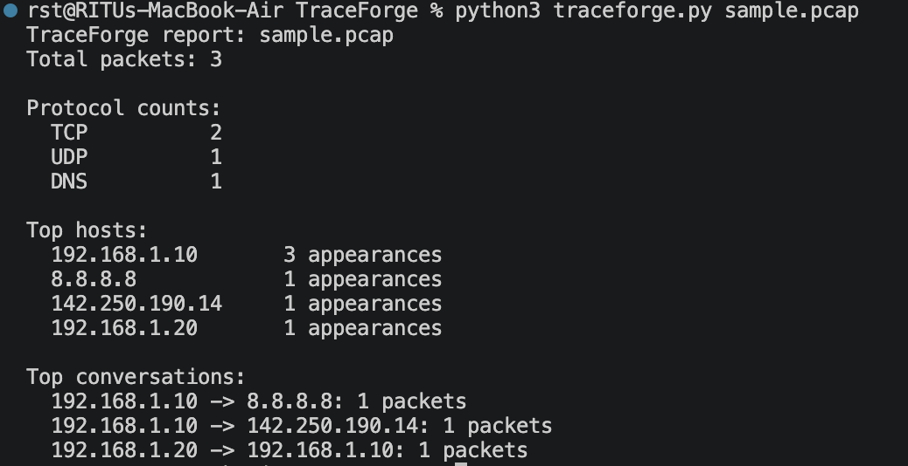
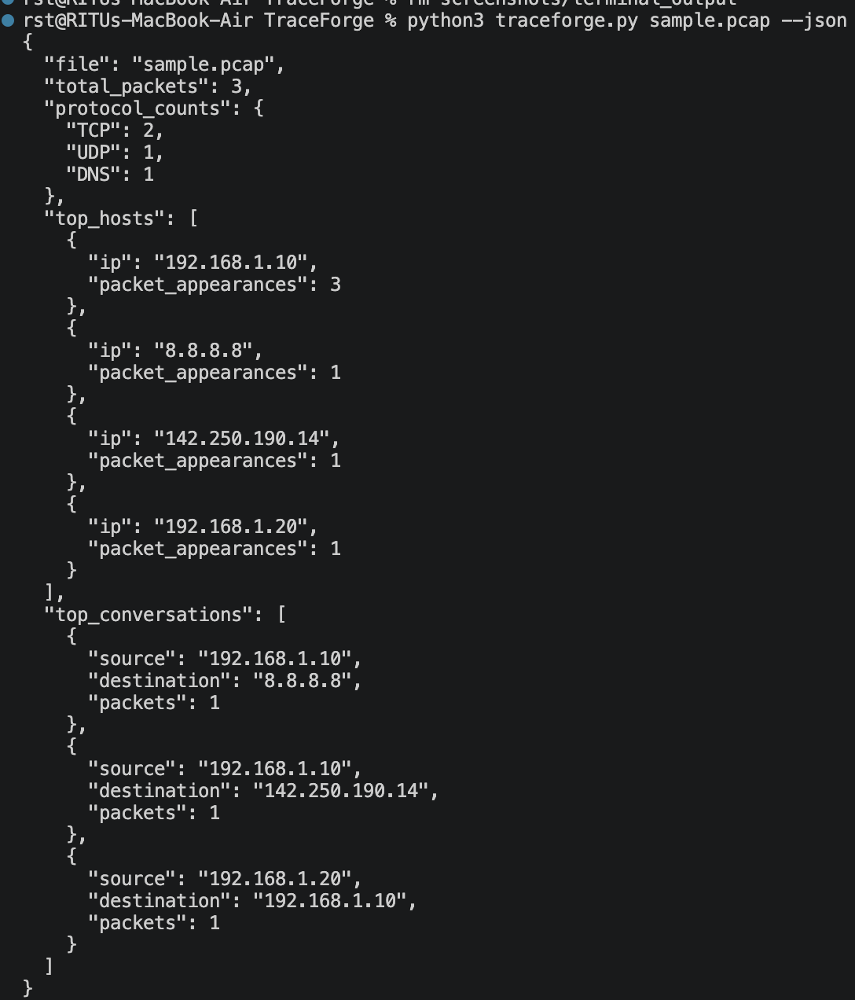

# TraceForge 🔍

**An Offline PCAP Analyzer Built with Python**

TraceForge is a beginner-friendly network traffic analysis tool that analyzes existing PCAP and PCAPNG files using Python and Scapy. It provides a clear summary of network protocols, frequently observed IP addresses, and source-destination conversations.

TraceForge works entirely with saved packet captures. It does not sniff live network traffic or transmit packets.

## ✨ Features

- 📂 Supports `.pcap` and `.pcapng` capture files.
- 📊 Counts TCP, UDP, DNS, other IP, and non-IP packets.
- 🌐 Identifies frequently observed IP addresses.
- 🔄 Summarizes source and destination conversations.
- 📄 Generates readable terminal reports.
- 🧾 Supports JSON output for structured analysis.
- 🔒 Works offline with previously captured network traffic.

## 🛠️ Technologies Used

- Python 3.10+
- Scapy
- JSON
- Python Unit Testing

## 📋 Requirements

- Python 3.10 or later
- Scapy

## ⚙️ Installation

**1. Clone the repository**

```bash
git clone https://github.com/Ritu-parna-j/TraceForge.git
```

**2. Navigate to the project directory**

```bash
cd TraceForge
```

**3. Install dependencies**

```bash
python3 -m pip install -r requirements.txt
```

## 🚀 Usage

**Analyze a PCAP file**

```bash
python3 traceforge.py sample.pcap
```

**Generate JSON output**

```bash
python3 traceforge.py sample.pcap --json
```

Use a PCAP file that you created yourself or one explicitly provided for training. You can use Wireshark to create a packet capture on your own device.

## 🧪 Run Tests

Execute the unit tests using:

```bash
python3 -m unittest discover -s tests -v
```

## ⚙️ How It Works

1. Scapy reads the saved packet capture file.
2. TraceForge identifies packets containing an IP layer.
3. It counts TCP, UDP, and DNS packets.
4. It records IP address appearances and source-destination conversations.
5. It generates a readable summary or JSON report.

## ⚠️ Limitations

- TraceForge is an educational tool, not an intrusion detection system.
- It does not determine whether network traffic is malicious.
- Host counts represent packet appearances, not unique devices.
- Host and conversation summaries are limited to IP-based packets.

## 🔐 Responsible Use

TraceForge is intended for educational and authorized network analysis.

- Analyze only packet captures you created or have permission to inspect.
- Do not publish packet captures containing sensitive information.
- Protect private IP addresses, URLs, and unencrypted data found in captures.

## 🎯 Learning Objectives

This project demonstrates practical concepts in:

- Network traffic analysis
- PCAP file processing
- TCP, UDP, and DNS protocols
- IP addressing and packet layers
- Python data structures and counters
- JSON report generation
- Unit testing

## 🔮 Future Improvements

- Protocol distribution visualization.
- Advanced packet filtering.
- Exportable analysis reports.
- Additional network traffic statistics.
- Improved reporting and analysis features.

## 👩‍💻 Author

**Ritu Parna J**

GitHub: [@Ritu-parna-j](https://github.com/Ritu-parna-j)

---

⭐ If you find TraceForge interesting, consider starring the repository!
## 📸 Project Screenshots

### Terminal Analysis Output



### JSON Analysis Output

